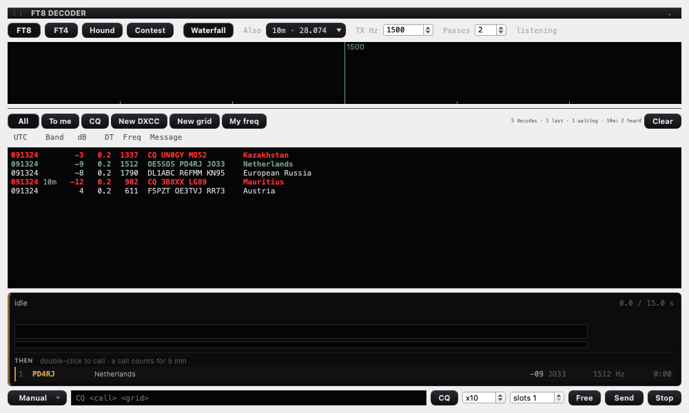

# FT8 auf zwei Bändern (2026-11-19)

Betreiber: „ich will 2 bänder, mehr macht derzeit mein trx nicht, gleichzeitig
empfangen umd ggf. eine dxcc station zu hören." Später: „ich werde immer nur eine
Antenne verwenden!!!" und „aber nicht automatisch senden … erst dann nach tunen."

## Was das Gerät kann (gemessen, nicht geraten)

Erkennungsruf der FLEX-8400 am 2026-11-19, passiv auf UDP 4992 mitgehört:
`max_slices=2 available_slices=1 max_panadapters=2 available_panadapters=1`.
Zwei Scheiben, also höchstens zwei Bänder. Eine SCU, also teilen beide Scheiben
EINEN Antenneneingang (FlexRadio-FAQ „one antenna at a time“ für 1-SCU-Geräte).

Ton je Scheibe gibt es nur über DAX (SmartSDR-API, TCPIP slice / stream):
`slice set <n> dax=<k>` + `stream create type=dax_rx dax_channel=<k>`. Der Strom
`remote_audio_rx`, den Longpath sonst hört, ist der Mix aller Scheiben.

## Gestaltung (vom Betreiber gewählt)

- **1A**: Feld „Also" hinter „Waterfall" — Off oder ein Band auf seiner
  FT8-Anrufstelle; 15 m ↔ 10 m zuerst. Ab Werk „Off".
- **2B**: vom zweiten Band nur neue DXCC-Länder, mit grauer Bandmarke nach UTC.
- **3A**: Doppelklick darauf tauscht die Bänder; es wird nichts gesendet.

Entwurfsblätter: `~/Longpath/werkzeug/entwuerfe-ft8-mehrband-2026-11-19/`.

## Wie es gebaut ist

| Stück | Datei | Aufgabe |
| --- | --- | --- |
| Lauschscheibe | `src/core/FlexLauschscheibe.{h,cpp}` | anlegen (im Panadapter, auf der Hauptfrequenz) → `audio_mute=1` → `dax=1` → `slice tune … autopan=0` → `stream create type=dax_rx`; Abbau; erkennt ihre Meldungen |
| Weiche | `RadioModel` (Flex-Zustand, Frequenz, Ton) | Meldungen der Lauschscheibe sieht kein anderer Weg; ihr DAX-Ton geht allein an AudioEngine-Lauschplatz 0 |
| Abgriff | `AudioEngine::setFt8LauschTap/feedFt8LauschAudio` | eigener Ring + Wandler je Platz, nicht durch `rxBlockReady` (kein Mix, keine fremden Abgriffe) |
| Fenster | `Ft8Applet` | zweiter `Ft8Stream`, Feld „Also", Filter auf neue Länder, Bandmarke, Tausch |

## Am Gerät zu belegen

- DAX liefert bei `audio_mute=1` weiter Ton — Protokoll: „Flex-Lauschscheibe:
  erster DAX-Ton …".
- Der Panadapter bleibt beim Anlegen/Stimmen der Lauschscheibe stehen.
- Welchen Filter die DIGU-Lauschscheibe ab Werk hat.
