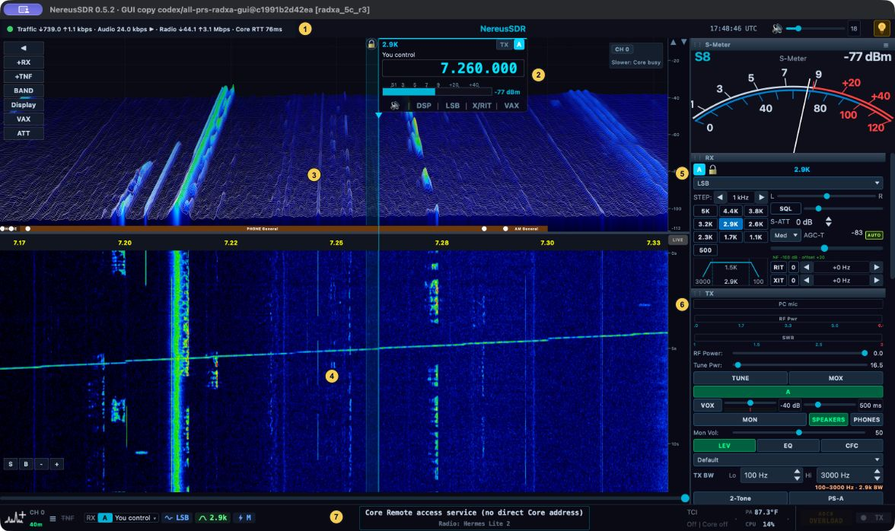
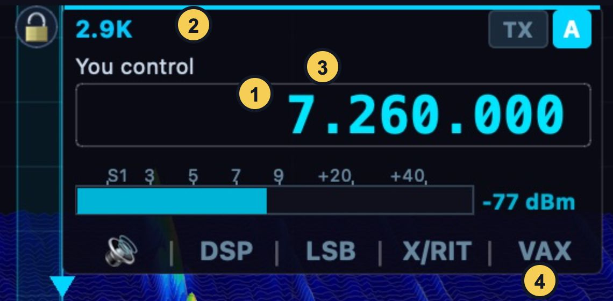

# Get to know the desktop window

The main window brings together the radio's spectrum, waterfall, slice
controls, receive audio controls, transmit controls, and status. The spectrum
shows signal level against frequency; the waterfall shows how signals
change over time. A slice is a receiving channel with its own frequency and
demodulation settings. A panadapter is the spectrum and waterfall area that
displays a frequency span.

The VFO flag identifies a slice and marks its tuned frequency on the
spectrum. Selecting a flag makes that slice active for controls that act on
the selected slice. Other slices can remain visible and continue receiving.
The operating controls are arranged in applets around the display; which
applets are visible depends on the current layout. The TX applet contains
transmit controls such as **TUNE**, **MOX**, **MON**, and the TX profile
selector. Read the state shown on the control itself before using it.

Connection status appears in the window's status area. When operating through
a shared Core, the window can also show who currently holds transmit. These
status indicators describe the Core's shared radio state, while controls
such as the selected slice and its mode belong to that receiver.

## Orient yourself before operating

1. Connect a radio or Core and wait for the spectrum to update.
2. Find the VFO flag on the spectrum and note its slice letter. Select the
   flag to make that slice active.
3. Locate its frequency, mode, and filter controls, then find the RX audio
   and DSP controls in the slice applet.
4. Locate the TX applet and read the labels and active states of its
   controls. Leave **MOX** and **TUNE** off while you are only receiving.
5. Check the connection indicator before interpreting a stopped or frozen
   display. If the radio is disconnected, reconnect from **Radio**.

The displayed frequency span is a view of the radio's received spectrum.
Changing the active slice changes which receiver's controls are being
edited; it does not automatically change the receive settings of every other
slice. Later chapters cover tuning, slices, and transmitting in detail.

## Desktop control map

Figure 1. The desktop window in the workspace look, receiving LSB on slice A.
It was rendered offscreen with fixed illustrative data, so the values shown are
examples and not a live station. The **OVERLOAD** indicator is present but not lit.

| Callout | Area | What to check |
| --- | --- | --- |
| 1 | Connection and traffic | Connection state, audio traffic, and Core round-trip time. |
| 2 | Selected VFO flag | Slice letter, frequency, filter width, and control ownership. |
| 3 | Spectrum | Signals across the displayed frequency span. |
| 4 | Waterfall | Signal activity over time. |
| 5 | RX applet | Mode, step, filter, AGC, and receive offsets. |
| 6 | TX applet | Transmit state, power controls, monitor, profile, and bandwidth. |
| 7 | Status banner | Current slice, Core/radio identity, and operating warnings. |

Figure 2. The flag's frequency field (1), filter width (2), ownership text
(3), and control tabs (4). **You control** identifies an editable slice;
a listening slice has different ownership text and restricted controls.

## Choose the control surface you need

The app offers several views of the same receiver. You do not need to keep
every applet open to operate a slice.

| Surface | How to reach it | What it controls |
| --- | --- | --- |
| VFO flag audio page | Click the speaker tab at the foot of the flag. | AF, AGC, stereo pan, mute, binaural audio, playback destination and squelch. |
| VFO flag DSP page | Click **DSP**. | Noise blankers, noise-reduction method, automatic notch, spectral blanker and CW peak filter. |
| VFO flag mode/filter page | Click the tab showing the current mode, such as **LSB**. | Mode selection and that mode's filter presets. |
| VFO flag offset page | Click **X/RIT**. | Receive and transmit offsets, their enable/reset controls and tuning step. |
| VFO flag virtual-audio page | Click **VAX**. | The slice's virtual-audio routing controls. |
| RX applet | Show RX in the **Containers** menu's **Applets** section. | Selected-slice mode, filter, antenna selections, tuning step, balance, attenuation, AGC and offsets. |
| TX applet | Show TX in the same section. | Transmit slice, drive, tune drive, keying, monitoring, processing, profile and transmit bandwidth. |
| Phone / CW applet | Show the applet when it is available. | The implemented microphone source, input gain, level/compression displays and phone processing controls. |
| Rotor applet | Show **Rotor** in the same section. It is always available. | The antenna rotor: **TURN TO** a bearing, **STOP**, **PRESETS**, and **Short path** or **Long path**. With no rotor set up it stays in the panel, its controls grayed with the reason. |
| Settings window | **File > Settings...** | Detailed parameters and device/Core setup, organized in a page tree. |

Clicking an already-open flag tab closes its controls; clicking a different
tab switches the panel. The flag can therefore remain compact while you
listen, then expand for one adjustment. The mode name on the tab is a useful
readback: changing the mode also changes the applicable filter choices.

Click the flag's slice letter to fold the flag down to the letter with the
frequency beside it. A click on the folded flag opens it again, and the wheel
still tunes. Each receiver remembers whether its flag is folded.

Before changing an RX applet control, check its slice letter. When there is
more than one slice, the RX applet's letter tabs provide another way to choose
the active slice. A setting entered in one surface should be reflected in
other views of that same slice. If it appears to affect the wrong receiver,
check selection and ownership before repeating the change.

## Show, hide and float applets

1. Open **Containers**. In its **Applets** section, check the applets you
   want visible. The panel's **☰** menu provides the same visibility choices.
   Checking an applet whose container is hidden shows that container too and
   brings its window where you can reach it. A check reads on only while the
   applet can be seen.
2. If an entry is unavailable, read its reason or check the corresponding
   station feature. For example, the amplifier and tuner applets depend on their
   enabled accessory connection. The **Rotor** applet is never grayed in the menu. A checked preference does not make an unavailable
   device appear. An unavailable applet stays in its container, grayed, with
   the reason under its title.
3. Applets live in containers. A container's header carries **↗**
   (tooltip **Pop out**); click it to move the container, with its applets,
   into its own window. **Pop Out** is also in the container's right-click
   menu. Place a frequently used TX or audio panel on a second monitor while
   retaining the band view on the main display.
4. A popped-out window shows **↙** (tooltip **Return**) in the same place.
   Click it to put the container back where it came from.

Floating an applet and floating a panadapter are different actions. An applet
window contains controls; **View > Float active pan…** detaches the selected
band display. A meter container is a third kind of window. Its items and
layout are managed with **Containers > New Container...** and
**Containers > Edit Container**. See the customization chapter for meter
layout work. Hiding a control panel does not release a slice or stop the Core.

### Arrange the workspace

The main window opens in the workspace look. Every container has a header, and
the header is where you move, pop out, hide and set up that container. Hidden
headers take no room, so the content fills the container.

- The grip on the header (**Drag to move**) moves the container.
- The eye button switches the header between staying visible and hiding when
  you are not arranging. An open eye (tooltip **Hide this header when not
  arranging**) keeps it; a crossed-out eye (tooltip **Keep this header
  showing**) lets it hide. **Keep Header Showing** in the container's
  right-click menu is the same switch.
- **↗** is **Pop out**, **⋯** is **Options**, and **✕** is **Hide. Bring it
  back from the Containers menu.**
- A popped-out window adds a pin: click it (**Keep this window on top**) to keep
  the window above other windows, and click again (**Stop keeping this window
  on top**) to release it.

To show every header, including hidden ones, hold **Shift** by itself for about
a third of a second; they stay until you let go. Shift with a click, a wheel
turn or another key does not do this, so tuning with Shift held works as
before. To keep arranging without holding a key, choose **Containers > Arrange
Workspace** (Ctrl+Shift+A); it is checkable, and **Escape** leaves it.
Arranging does not change which headers are shown or hidden.

While arranging, drag a container by its header and let go where you want it:

- Near any of the four edges of the main window, a box shows where it will
  land, and it docks there.
- Over the spectrum, it sits free where you dropped it.
- Outside the main window, it becomes a window of its own.

This works the same for a docked container, a free one and a popped-out window.
**Escape** during a drag puts the container back where it started. When you are
not arranging, dragging a window only moves it, so you can park a window over
the main window without docking it. **Containers > Align to 8 px Grid** makes
free and floating containers settle on an 8 pixel grid when moved; hold **Alt**
to place one freely.

**Return** puts a popped-out container back where it was popped out from: the
same strip, beside the same neighbor, or the same free place. A window that was
never docked joins the Main Panel's strip.

There is no **Lock** in this look. A container whose header is hidden has
nothing to grab, so it cannot be moved by accident, and a container saved as
locked opens unlocked. Every container and window starts where you left it, at
the size you left it, on the monitor you left it on; if that monitor is not
connected the window opens on the main window's screen. A window that would
be shown with its header off every screen, or is left there when a monitor is
added, removed or resized, is moved back where you can reach its header.

**Containers > Hidden** lists everything that was taken off the screen (a
header's **✕**, **Hide container (retain placement)**, a closed floating window
or an applet you unticked, and containers hidden on receive, on transmit or by
a macro) so you can bring it back where it was. It reads
**Nothing hidden** when the list is empty. **Containers > Reset Default Layout**
removes the containers you added and restores the standard layout, with the
S-Meter showing first; it sits next to **Edit Container** in the menu.

### Workspace profiles

A workspace profile holds where your containers sit. Switching profiles never
changes a slice, frequency, mode or filter.

- **Containers > Manage Workspace Profiles…** opens **Workspace Profiles**. Its
  buttons are **New** (**Empty** or **From Current Arrangement**), **Duplicate**,
  **Rename**, **Save**, **Export**, **Import** and **Remove**; double-click a
  profile to switch to it.
- A profile rail sits in the title bar, just left of "NereusSDR". It rests as a
  badge for the active profile and fans out on hover, click or Tab. Right-click
  a badge for **Save Now**, **Export…**, **Import…**, **Rename…**,
  **Duplicate…**, **Remove** and **Manage Profiles…**.
- Ctrl+1 to Ctrl+9 (Command on macOS) switch to the first to ninth profile.

## Make the band display useful

The spectrum, waterfall, frequency ruler and level ruler respond to different
mouse gestures. Put the pointer on the part you intend to change.

| Gesture | Result |
| --- | --- |
| Click an empty point in the spectrum/waterfall without dragging. | Tune the active slice to that frequency, rounded to its tuning step. |
| Drag an empty area horizontally. | Pan the displayed frequency window. |
| Drag within a receiver's passband, or near its center line. | Select that receiver if it is not selected, and slide it to a new frequency. Where receivers overlap, the selected one moves. |
| Drag a VFO flag sideways. | Tune that slice by the distance dragged. A plain click still selects, folds or unfolds the flag. |
| Drag a passband edge. | Adjust a receive filter edge. |
| Drag the spectrum/waterfall divider vertically. | Allocate more height to either display. |
| Drag the frequency scale horizontally. | Change the displayed bandwidth. |
| Ctrl+wheel, or Command+wheel on macOS, over the band. | Zoom the frequency span around the VFO. |
| Shift+wheel over the band. | Adjust the display's reference level. |
| Wheel over the dBm scale. | Adjust the displayed level range. |
| Ctrl+left-drag (Command on macOS) on the dBm scale. | Change how much range the scale shows. |
| Left-drag the dBm scale. | Move its level window up or down. |
| Right-drag the dBm scale. | Stretch the range. |

On a trackpad, two-finger tuning moves one step for each short stretch of
travel, at most 20 steps a second, and stops when your fingers lift. A mouse
wheel moves one step per notch.

A notch under the pointer takes precedence over ordinary tuning gestures;
its wheel action resizes the notch. If a wheel turn unexpectedly changes
an interference marker instead of frequency, move clear of the marker or
use the VFO frequency field.

Zooming and panning are display operations, but a view extending beyond the
current receive window can show survey data outside the listenable area.
Choosing a signal in that outer area can require the Core to move its
receiver window. Read any impact/refusal message when other slices share
that receiver. A visible signal and an available receiving channel are
separate things.

The display remains pannable and zoomable while keyed, but ordinary band
click-to-tune is withheld during transmit. Return to receive before making
an operating-frequency change; do not use display movement as confirmation
that the transmitter changed frequency.

## Inspect earlier waterfall activity

The waterfall has a history view as well as a live view. Drag its time-scale
strip to inspect previous rows. Use **LIVE** to return to the current band.
An old trace can help identify when a signal started or where interference
appeared. It does not mean a station is transmitting at that frequency now.

When a display seems frozen, first check whether it is showing history. Then
check connection state, Core traffic and the status message. Distinguish a
paused history view from missing data before reconnecting the station.

## Read meters and status together

The receive meter describes signal level in the selected receiver. The TX
meters describe microphone level, RF power and SWR in their applicable
operating state. A displayed meter face is not evidence of fresh samples.
For example, while receiving, the TX applet's **Power** and **SWR** gauges show dashes, and a forward-power display on another meter may be zero or retain its last indication; use it during the controlled transmit operation it is intended to measure. When a connected Power Genius XL or RF2K-S is in OPERATE, the main power and SWR meters read that amplifier's output instead of the radio's, and while you transmit, the TX applet shows the radio's own power as a small **DRIVE** figure beside the gauge name. Standby or disconnecting the amplifier returns the meters to the radio.

Connection/traffic indicators answer a different question: whether this
window is receiving data from its radio or Core. Core round-trip time is a
control-link measurement. Audio traffic is evidence that data is arriving,
but playback also requires a working output route, volume and unmuted slice.

## Use the connection and station context menus

Right-click the connection/segment area for its connection actions. In a
local radio window it includes **Disconnect**, **Connect to other radio…**,
**Network diagnostics…**, **Copy IP address** and **Copy MAC address**.
In a remote window it instead offers the actionable Connect/Disconnect
commands, **Core connection details...**, the Core's radio-management actions
and address-copy entries when the Core has reported them. Copied addresses
refer to the radio identified by that menu, so inspect the identity first.

Right-click the station block for radio-management actions. In a local window,
**Edit radio…** opens management for the current radio. **Forget radio**
disconnects and removes its saved radio entry; use it deliberately rather than
as a first recovery attempt. In a remote window the available actions target
the Core's radio and obey its permission/readiness gates. See
[connection management](01-desktop-connect.md) for the full saved-target flow.

Use **Radio > Protocol Info** to inspect the radio/protocol details, and
**Tools > Network Diagnostics** for the link measurements. When a status
message appears, capture its wording and the affected Core/radio/slice before
changing settings. **View > Performance Overlay** exposes performance presentation;
read whether a CPU value represents this computer, the app or the Core.
An overload indication is an input condition, whereas Core busy and link/audio
notices point to different resources. [Troubleshooting](11-troubleshooting.md)
uses those distinctions to choose the next check.

## Check that controls follow your selection

For a practical orientation check, select slice A, open its audio tab and
change AF by a small amount while listening. Confirm both the number and the
sound change. Then select another slice and verify its identity before using
the same control. This establishes which controls follow selection without
keying the transmitter or changing station hardware.

## Set the PC and RADIO listening volume

The title bar has two volume controls, each a speaker button with a slider and a level readout from 0 to 100.

- **PC** is this computer's speakers. Click the speaker to mute or unmute; drag the slider to set the volume. It is the same control as **Volume** under **This computer** in **File > Settings... > Audio > Outputs**. It does not change the headphones.
- **RADIO** is the radio's own speaker output. It plays the receiving slices, and each slice's AF level and mute still apply. In a window connected to a remote Core it is the speaker at the Core, shared with every window and the phone, and its tooltip reads **Radio speaker at the Core (shared with every window and the phone)**. With no radio connected it is grayed and its tooltip reads **No radio connected**; on a Hermes Lite 2 without the audio add-on board the tooltip adds that it needs the board.

PC mute can silence a correctly configured slice, so check it before changing receiver gain or the Core's DSP. PC also controls this computer's playback in a remote desktop window.

Point at the PC speaker for its tooltip: **PC volume. Click to mute, right-click for speakers.** If the chosen device is missing or held by another program the tooltip adds that, and where the sound plays meanwhile. Right-click the PC speaker for the speakers menu. Its heading names the driver in use, for example **SPEAKERS · CORE AUDIO**, followed by:

- **(platform default)**, then each device on that driver, with the current choice ticked. An interface with several pairs lists each pair under the interface's name.
- A missing choice in amber at the top, ticked, as **<name> (not connected)** or **<name> (in use by another program)**, with **Playing on <device> until it comes back.** beneath it.
- **No ASIO devices present** when ASIO is the driver and none is installed.
- **The device lists are not ready.** with the entries grayed, shortly after start.
- **Sound setup…**, which opens Audio > Outputs.

Choose the intended device and listen at a comfortable volume. The menu changes this computer's speakers only. It does not change the station's microphone input or a different operator's phone output. A newly plugged in device appears in the menu within about a second. The selected slice's personal volume and mute remain a separate stage, so check both when one slice is silent. Use [Audio > Outputs](01-desktop-connect.md#choose-this-computers-receive-and-transmit-audio-routes) to inspect the opened format or repair a missing route.
