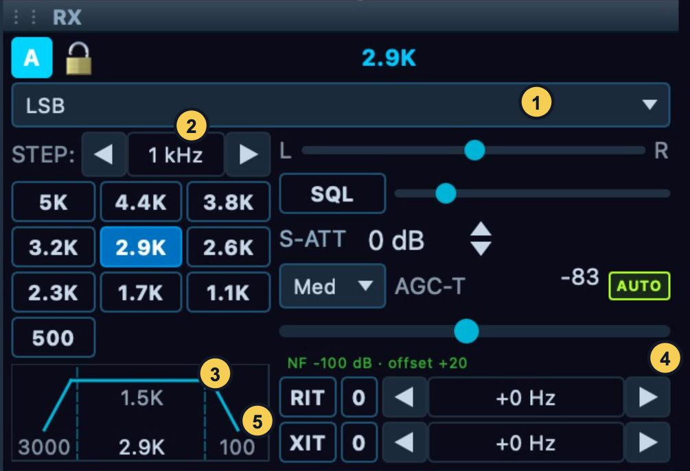

# Tune and receive

This chapter follows a receive session from selecting a slice to tuning,
filtering and managing interference. Frequency, mode, filter and receive DSP
changes apply to the slice you control. A slice you only listen to has restricted
controls; its **Your volume** and mute remain personal to this device.

Figure 3. Mode (1), tuning step (2), filter display and presets (3),
AGC/AUTO controls (4), and receive/transmit offsets (5). The illustrated
values are the capture's illustrative settings, taken in the workspace look from the preview window with no radio connected.

## Start with the right slice and route

1. Connect and wait for fresh spectrum data. Select the desired VFO flag,
   or its letter tab in the RX applet when several slices are present.
2. Read the slice letter, frequency and ownership line. Take control if
   necessary before changing its receive settings.
3. Open the flag's speaker tab. Select **SPEAKERS** or **PHONES** for the
   intended output, unmute it and set a comfortable **AF** level. Those
   output names use the devices selected in **File > Settings... > Audio > Outputs** (the **This computer** and **Headphones** cards).
4. Check mode, filter and offsets before evaluating a signal. A leftover
   RIT offset or an inappropriate filter can make a correctly entered VFO
   frequency sound wrong.

With multiple receivers, audio from more than one slice can be mixed into
your output. Temporarily mute the others when diagnosing the selected
receiver, then restore the mix. Do not change several receivers' DSP settings
merely because the combined audio is difficult to understand.

Each receiver keeps its own settings. A change is saved to the receiver you
made it on, and after you close and reopen NereusSDR every receiver comes
back with its own L/R pan, binaural, squelch, APF, FM settings, DIGL and DIGU
offsets, RTTY mark and shift, and AGC-T AUTO.

## Tune by frequency, signal position or step

For a known frequency, double-click the flag's frequency display, enter an
explicit value such as `7.260 MHz` or `7260 kHz`, and press **Enter**. Confirm
the displayed readback. Leaving the entry without submitting it returns to
the frequency display. Use explicit units when moving between MHz and kHz to
avoid an unintended interpretation.

For an unknown signal, click its position in the spectrum or waterfall.
A short click tunes the active slice to the nearest selected tuning step.
Dragging empty space pans the view; dragging inside a receiver's passband,
or near its center line, selects that receiver and slides it. Dragging a VFO
flag sideways tunes its slice. The gesture table in [the window chapter](02-desktop-window.md)
shows which parts of the display change tuning, filters or presentation.

For small corrections, use the wheel over the VFO frequency field or over an
empty area of the band. The RX applet's **STEP** arrows move through the
available step choices and wrap at the ends. The step button in the flag's
**X/RIT** page cycles choices too. Choose a small step for fine alignment and
a larger step for band exploration. The step controls the increment and
click rounding; it does not change the receive filter width. Each slice keeps
one step on every band.

If a change is refused, check the lock icon and ownership text. Unlock a slice
you control, or request **Take control** for one you only hear. Check the
Core's message when the requested frequency requires moving a shared receive
window. Changing a local display is not proof that the Core accepted a radio
retune: use the final frequency and received audio as confirmation.

## Change bands and inspect the recalled state

Use **Band > HF** and choose the named band, or select **GEN** for general
coverage or **WWV** from the Band menu. The BAND button on the pan and band
buttons in containers do the same. On a Core with band stacks, a band opens at
your slice's place in that band's stack, and pressing the band you are on moves
to the next saved spot (see [band stacks](#save-and-recall-spots-with-band-stacks)).
Without band stacks, a band opens where the slice last was on it: its
frequency, mode and filter. A first visit uses the band's starting state. WWV
is not a promise that every click lands on a fixed 10 MHz frequency. Read the
recalled VFO, mode and filter before tuning further.

Check the antenna and hardware filter readbacks when changing bands because
the physical station can have different per-band routing. A band choice does
not extend the connected radio's frequency range or add a transverter. VHF and
transverter bands are not implemented in this build, and transverter bands
have no band stack.

## Save and recall spots with band stacks

Each band keeps a list of saved spots. A spot holds a frequency, mode and filter, and how the pan was centered and zoomed. The list lives on the Core, one for each radio, so every window and phone on that Core shares it. Each slice keeps its own place in the list. A Core that does not have band stacks shows the controls grayed with **This Core does not have band stacks. Updating the Core may help.**, and band buttons work as they did before.

**Press a band button.** Any band control works: the BAND button on the pan, the **Band** menu, or a band button in a container.

- On another band, the slice goes to its place on that band.
- Pressing the band you are already on saves any change to the spot you are on, then moves to the next spot. After the last spot it goes back to the first.
- Hold Shift to move to the previous spot instead.
- Hold Ctrl (Command on Mac) to add where you are now as a new spot.

From the keyboard, **M** goes to the next spot on the selected slice's band and **N** to the previous one, wrapping at the ends. **Shift+M** adds where you are now as a new spot. These are hot keys; change them under **File > Settings... > Keys and controllers > Keyboard**.

The BAND button's list stays open after a press, so you can keep pressing. Click elsewhere to close it. Each press shows a short note such as "40m: 7.185 LSB, 5 of 6". The status bar shows the band and your place, such as **40m 5/6**. A dash in place of the number, as in **40m -/6**, means the slice has no place on that band.

**Open the list.** Choose **Band > Band Stacking...** or click the three dots on the status bar, or press **Shift+N**, which also closes it. The **BAND STACK** panel opens beside the panadapters, for the selected slice. Drag its edge to make it wider.

- Click a band's header to open or close it.
- Click a row to go to that spot.
- Double-click a row, or press F2, to rename it.
- Drag a row up or down to change its place in the band.
- **+ Add current spot**, at the foot of the band you are on, adds where you are now.

For a quick look at one band, right-click its button on the BAND list or in a container. The band's spots open at the pointer.

**Row menu.** Right-click a row for **Go there**, **Save current spot here**, **Rename**, **Lock** or **Unlock**, **Always return here** and **Delete**. Delete does not ask first. A locked spot is never changed by leaving it or by clearing, but you can still go to it, rename it or delete it.

**When a spot saves.** Leaving a spot by a band press or a step saves your changes into it, unless the spot is locked or another slice is on it. Going back to your own row returns to what it holds and saves nothing, so it undoes any tuning. If you tuned into a band by hand, from another program or from another device, your spots there are left alone, and that frequency is not kept unless you add it. To keep a frequency on purpose, use **Save current spot here** or add a new spot.

**Band menu.** Right-click a band's header. **Return to** chooses where a press on that band takes you: **Current entry** (the default) goes to your place, **Last frequency used** goes to exactly where you left the band, and **Specific entry** goes to the spot marked **Always return here**. **Clear unlocked** entries for the band asks first.

**Panel menu.** Click **⋯** in the panel's header.

- **Group by band**. With it off, all spots show in one list in frequency order.
- **Auto-expiry** removes unused spots after the time you choose. It never removes locked spots, the region's default spots, or a spot a slice is on. A note offers **Undo** for 5 seconds.
- **Auto-save dwell** adds a spot when you stay on a frequency for the time you choose.
- **Don't save over a frequency already here** keeps one spot per frequency on a band. It is on by default.
- **Show on the spectrum** marks each saved spot on the panadapter. Click a mark to go there, or right-click it for the row menu. The marks hide while you transmit.
- **Reset to region defaults...** and **Clear unlocked entries...** each ask first.

Auto-expiry and auto-save dwell are off to start, and they are the Core's settings, shared by every device. Group by band and Show on the spectrum are kept on this computer. The **STACK+** and **STACK-** container buttons step through the band's spots for the container's slice.

A recall also brings back the band's usual settings, such as AGC and the noise blanker. It leaves the sample rate and tune step as you set them. If the slice has its pan to itself, the saved zoom and center come back too. A press is refused on a locked slice, a slice that is transmitting, and a slice you only listen to. If you change **Region** in Setup, NereusSDR asks whether to replace your unlocked spots with the new region's defaults; **Keep my entries** leaves them as they are.

Use **View > Band Plan** to select a shown plan and its label size, from Off
through Huge. Check the highlighted segment and frequency scale. A band-plan
label is operating context; it does not choose your receive mode or grant TX
permission. Keep it legible without obscuring the passband.

## Select the mode before the filter

Choose the mode in the RX applet, open the flag's mode tab and select it
there, or use the **Mode** menu. The current mode name is shown on the flag and
changes the preset bank. The RX applet and the flag's mode list offer every
mode except **SPEC**; only the **Mode** menu offers all 14, so choose **SPEC**
there. When the experimental RADE2 modes are turned on (see
[chapter 15](15-rade-freedv.md#turn-on-the-experimental-rade2-modes)), each
list gains **RADE2-U** and **RADE2-L**, and the **Mode** menu offers 16.

| Mode family | What to check in NereusSDR |
| --- | --- |
| **LSB**, **USB** | Correct sideband, voice passband, AGC and receive noise treatment. |
| **CWL**, **CWU** | Sideband, narrow receive filter and CW peak-filter settings when used. |
| **AM**, **SAM**, **DSB** | Appropriate demodulation and filter for the signal. Separate SAM setup options are not all present in this build. |
| **FM** | Receive filter and squelch. FM transmit/repeater/tone controls are not implemented in the covered desktop build. |
| **DIGU**, **DIGL** | Sideband and audio passband expected by the external decoder, plus its audio route. |
| **DRM** | A mode choice does not itself configure an external digital decoder or audio connection. |
| **SPEC** | A receive/spectrum mode choice; it cannot be used for transmit. |
| **RADE-U**, **RADE-L** | Correct sideband and RADE profile/status, using the digital-voice instructions. |
| **RADE2-U**, **RADE2-L** | Experimental, and shown only after the Core turns them on. Same sideband and status checks as RADE-U and RADE-L; no callsign is decoded. |

A mode label describes how the slice demodulates. It does not by itself
select the transmitter, establish a software audio route or connect a
reporting service. Check those separately when using digital modes.

## Choose and adjust the receive passband

1. Select a filter preset in the RX applet or flag's mode/filter page.
   The buttons show their widths, and their tooltip identifies the preset
   and low/high edges. Confirm the shaded passband and width readback.
2. Listen before narrowing it. Reduce the width when an adjacent signal is
   the problem; widen it again if the wanted signal loses useful content.
3. For a custom edge, drag the shaded passband edge in the spectrum, or use
   the RX applet's passband display. Check both edges after the change.
4. To reuse a shape, right-click a preset and choose **Edit this preset…**.
   Enter **Name**, **Low** and **High**, inspect **Width**, then **Save**.
   **Cancel** leaves the saved entry unchanged. **Reset this preset** restores
   that slot; the editor also provides **Reset to Default**.

Filter values are relative to the slice's tuned frequency. A lower-sideband
filter therefore uses a different placement from an upper-sideband one even
when both buttons show the same bandwidth. Check the actual edges, not only
the width. A narrower filter excludes more of the spectrum; it cannot make
an interfering signal inside the wanted passband disappear without also
removing some wanted audio.

The preset bank belongs to the Core. Editing a preset can affect other
operators who later select it. **File > Settings... > DSP > Filter Presets** provides the
larger editor with mode selection, names/edges, ordering and reset operations.
Choose the required mode and slot before editing; the covered editor does not
provide RADE rows in its ordinary WDSP preset list.

**Shift-click** on a receive preset is a special operation: it applies the RX
preset and requests a one-time copy of that passband to the transmit audio
filter. It does not establish continuous RX/TX tracking. TX settings permission
is still required; an RX change can succeed while the TX copy is refused.
Read **TX BW** afterwards if matching was your intention. Use an ordinary
click for receive-only filter selection.

## Set receive volume and AGC deliberately

| Control | Purpose and interaction |
| --- | --- |
| **AF** | Received-audio level for the selected slice. It does not select the computer's output device or alter TX monitor volume. |
| **Mute** | Silence the slice. On a listened slice this is personal to this device. |
| **Your volume** | Personal level for a slice controlled elsewhere; changing it does not change the controlling operator's AF setting. |
| **Pan** or L/R balance | Place the receiver's audio in the stereo image. Useful for distinguishing two listening slices. |
| **BIN** | Binaural playback, with I and Q in separate ears; evaluate using a stereo headphone route. |
| **SPEAKERS**, **PHONES** | Select which configured playback destination carries this receiver. |
| AGC mode | Set how automatic gain responds and recovers. |
| **AGC-T** | Set the AGC threshold, which in use is similar to traditional RF gain. Right-click the slider, on the flag or in the RX applet, to open **File > Settings... > DSP > AGC/ALC**. |
| **AUTO** | Derive AGC-T adjustment from the measured noise floor. In the RX applet, right-click **AUTO** to open **File > Settings... > DSP > AGC/ALC**; a left-click still turns it on and off. |
| **SQL** and threshold | Switch the SSB-style squelch and set its threshold on a 0 to 100 scale. Check this when spectrum is active but audio is absent. |

AF and AGC-T solve different problems. If audio is simply too loud, adjust
AF or output volume. If background noise is being raised between signals,
review AGC mode and AGC-T while holding AF steady. Changing AF alone cannot
repair an overloaded radio input.

The AGC choices in the flag/RX applet are **Off**, **Long**, **Slow**, **Med**
and **Fast**; the **DSP > AGC** menu adds **Custom**. In every mode AGC-T sets
the AGC threshold. **Off** does not use AGC-T: it holds the gain set by **Fixed
Gain** ("Gain when AGC is disabled") on **File > Settings... > DSP > AGC/ALC**.
Longer recovery
keeps gain from rising as quickly between parts of a signal; faster recovery
follows more rapid changes. Select one, listen across several signal changes,
then compare with the previous choice. The best choice depends on the signal
and conditions; this manual does not treat a captured setting as a universal
preset. Use **AUTO** when you want noise-floor-based adjustment, and check
its indication before making a manual AGC-T change. The line under AGC-T reads
**NF <n> dB · offset +<n>** once a noise floor is measured and **NF awaiting
measurement** until then. **AUTO** acts on the slice the applet is showing,
and each receiver keeps its own AUTO setting and offset on every band. A
window signed in to a desktop Core shows a real noise-floor reading too.

**AUTO** does not measure your own transmission. While the station is on the
air, including TUNE, two-tone and CW with QSK, it stops measuring and leaves
AGC-T where it was. After you unkey it measures again, using only signal
received after the transmission ended, so the first update can take a moment. A
window running its own radio keeps showing the held noise floor while you
transmit. A window signed in to a Core shows **NF awaiting measurement** until
the Core has a fresh reading.

## Set squelch without losing weak signals

Open the flag's speaker tab or the RX applet, enable **SQL**, and adjust its
threshold while listening to a clear gap between signals. Stop when the
unwanted background closes, then tune a wanted signal and confirm it opens
the audio again. If a weak signal disappears, reduce the threshold or turn
SQL off before trying stronger noise reduction. Squelch silences the output;
it does not remove an interferer from the passband.

The **SQL** button and threshold on the flag and in the RX applet are the
SSB-style squelch, on a scale of 0 to 100, whatever the mode. No control in the
flag or applet turns on AM or FM squelch. Their thresholds are on their own DSP
pages: **AM Squelch Threshold** in the **Squelch** group of **File >
Settings... > DSP > AM/SAM**, in dB from -160 to 0, and **Squelch Threshold**
on **File > Settings... > DSP > FM**, from 0 to 100, where 100 is the tightest
and a new receiver starts. Do not copy a number between these unlike
scales. In a no-audio
diagnosis, turn SQL off temporarily so that a closed gate cannot be confused
with the wrong output device. Tone squelch and FM repeater controls are not
implemented in this build.

## Use input attenuation and preamp controls

The RX applet's input controls can affect the ADC feeding several slices,
which makes them different from per-slice AF and AGC. The label may read
**ATT**, **S-ATT** or **A-ATT**, depending on stepped and automatic attenuation
state. The available range and preamp choices come from the connected radio.
A slice using the other ADC can have that ADC's own settings. NereusSDR
remembers the attenuator and preamp settings and sends them to the radio when
it connects, so check them after connecting to a radio you last used at a
different station. A desktop Core also keeps the changes that signed-in windows
and phones make while it runs.

If an ADC-overload indication appears, first identify the affected input and
current antenna/preamp/attenuation state. Increase available attenuation or
reduce unnecessary preamp gain while watching the overload indication and
wanted signal. If overload clears, compare reception before continuing.
Coordinate such input changes with operators sharing that ADC. Turning down
AF hides loud audio but leaves the radio input condition unchanged.

In a remote window these controls show and request the Core's input state.
Read the disabled control's reason if the Core does not offer it. Do not
assume the range or antenna/preamp arrangement of one HPSDR model applies to
another. Hardware setup and antenna routing are covered separately.

## Select noise treatment by the problem

Open the flag's **DSP** tab. The NR bank selects one noise-reduction method;
NB/NB2, SNB and the automatic notch are separate controls.

| Control | Implemented purpose and access |
| --- | --- |
| **NB** / **NB2** | Left-click cycles Off, NB, NB2, Off. NB targets sporadic time-domain impulses; NB2 adds hold/interpolation behavior for denser impulses. Right-click opens NB/SNB setup. |
| **NR1** | Adaptive LMS noise reduction. Right-click opens its parameter popup. |
| **NR2** | Enhanced multiband noise reduction. Right-click opens its parameter popup. |
| **NR3** | Recurrent neural-network noise reduction. Right-click opens its parameter popup. |
| **NR4** | Spectral baseline noise reduction. Right-click opens its parameter popup. |
| **DFNR** | DeepFilter noise reduction when offered by the Core/build. |
| **MNR** | macOS noise reduction when available. |
| **NNR** | Neural noise reduction with its settings/model choices. An amber indicator reports measured processing trouble while your selected model keeps running. Open the controls to choose Standard or turn NNR off; an older Core's applied limit is shown separately. |
| **ANF** | Automatic notch filtering for suitable unwanted tones. |
| **SNB** | Spectral noise blanker, independently switchable from NB/NB2. Right-click opens NB/SNB setup. |
| **APF** | CW audio peak filter, with its frequency adjustment where applicable. |

Start with the other treatments off and the receiver correctly tuned. Turn on
one treatment, compare speech or wanted tones with it on/off, and keep it only
if intelligibility improves. Excessive treatment can remove wanted detail or
introduce artifacts. Right-click a method for its frequently adjusted parameters;
**More Settings...** leads to its detailed DSP page where offered.
[Receiver DSP setup](13-receiver-dsp.md) explains those parameters and their
dependencies.

DFNR, MNR and NNR availability is reported by the controlling Core/build.
A disabled button's tooltip gives the reason; reconnecting repeatedly is not
an installation method for a missing processor or model. If a noise algorithm
makes audio timing worse, compare with it off and capture the processor/link
status before changing unrelated network or device settings.

## Remove a persistent tone with a manual notch

1. Tune and identify the unwanted tone in the passband. Right-click its
   frequency in an empty part of the spectrum and choose **Add notch here**.
   Check the frequency shown in the popup before applying it.
2. Confirm a notch marker appears. Enable **TNF** through the DSP menu or
   the status-bar TNF control if the master notch processing is off.
3. Drag the notch centre to align it, or drag an edge to change width.
   The wheel over a selected notch adjusts its width; Shift gives finer
   adjustment. Listen to the result rather than relying only on the marker.
4. Right-click the marker to choose **Width**, **Bypass Notch** / **Activate
   Notch**, or **Remove Notch**. Widths below the filter's achievable minimum
   are disabled and explain their minimum.

A notch is a frequency/width filter entry, not a new receive slice. Making it
wider can remove wanted audio too. The **TNF** master affects all notches,
whereas bypassing one entry leaves the other entries available. **File >
Settings... > DSP > TNF** provides the notch-management page for inspecting the bank and
its DSP settings. The notch menu does not provide a permanent/temporary
persistence choice in this build.

## Use RIT, XIT and CTUN for different jobs

**RIT** offsets received frequency without replacing the main VFO setting.
Enable it in **X/RIT** or the RX applet, adjust its signed Hz value and listen.
The **0** button clears its stored offset. Disabling RIT bypasses the offset;
check both enable state and value when returning to ordinary operation.

**XIT** offsets the transmitted frequency. It is not a receive correction.
Check it before every TX session, especially after listening to a signal that
needed RIT. The XIT offset is a slice setting; editing it does not itself grant
transmit ownership or key the radio. For a larger split, using a separate TX
slice can make the two operating frequencies clearer. A slice you add starts
with RIT and XIT off and both offsets at 0. A slice brought back when NereusSDR
starts keeps its own RIT and XIT.

**CTUN** concerns the receiver window and band view. Right-click empty spectrum
and enable **CTUN (independent pan)** under **Tuning** to keep the receive window
fixed while tuning within it. The VFO moves while the pan stays put. Turn it off
to return to a view following the VFO. The checkbox is grayed on a slice you
only listen to or a receiver another device holds, with the Core's reason as
its tooltip. When the Core does not provide remote C-Tune, it is grayed with
**C-Tune requires a connected Core with remote C-Tune support**. None of these three controls is a
substitute for selecting the intended transmit slice.

## Worked example: improve a weak voice signal

Start on a slice you control, with its output audible and no unexpected RIT/XIT.
Enter the known frequency, select the correct sideband, and choose a filter that
includes the wanted voice. Hold AF steady while choosing AGC mode and setting
AGC-T. If a nearby signal is entering at one edge, narrow that edge before
trying noise reduction. For steady background noise, compare one NR method
with Off. For distinct impulses, compare NB and NB2. For a single persistent
tone, compare ANF or a narrow manual notch.

Finish by reading the frequency, mode, width, offsets and active DSP buttons.
Restore treatments that failed the listening comparison to Off. If intelligibility
is still poor, capture the signal/overload and output-route observations before
following the troubleshooting chapter. This gives the next check a specific
symptom instead of an unexplained collection of changed settings.
